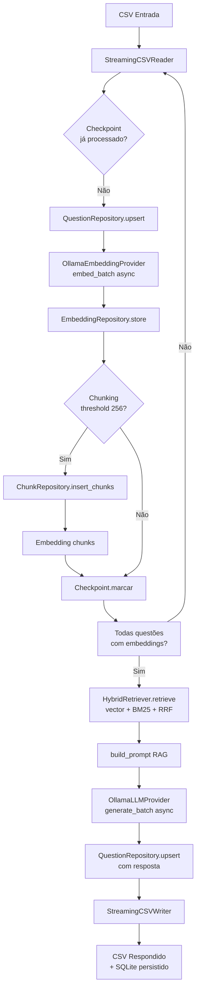

# SOMAIA — RAG de Questões Matemáticas com Ollama Local

> Pipeline modular de *Retrieval-Augmented Generation* para resolução automática de questões matemáticas, 100% offline, rodando modelos locais via Ollama.

---

## 🏗️ Arquitetura

```
src/
├── cli/                 # CLI Typer: run, run_async, evaluate
├── config.py            # Settings Pydantic (SOMAIA_* env vars)
├── db/                  # SQLite + sqlite-vec (schema, repository, connection)
├── pipeline/            # Orquestração sync/async, checkpoint, chunking, prompt
├── retrieval/           # HybridRetriever (vector + BM25 + RRF)
├── embedding/           # OllamaEmbeddingProvider (batch async)
├── generation/          # OllamaLLMProvider (batch async, fallback chat→generate)
├── io/                  # StreamingCSVReader/Writer (memória constante)
├── evaluation/          # Métricas tolerância (exact/numeric/symbolic + breakdown)
└── models/              # Question, RetrievedExample, DifficultyLevel
```

### Fluxo do Pipeline (Mermaid)



---

## 📋 Pré-requisitos

- **Python 3.11+**
- **Ollama** instalado e rodando (`ollama serve`)
- Modelos no Ollama:
  ```bash
  ollama pull qwen3:1.7b        # modelo de chat (padrão)
  ollama pull nomic-embed-text  # modelo de embeddings
  ```
- Dependências Python:
  ```bash
  pip install -r requirements.txt
  # Inclui: pydantic, pydantic-settings, requests, sqlite-vec,
  #         aiohttp, rank-bm25, sympy, numpy, typer, pytest, ruff, mypy
  ```

---

## 🚀 Instalação Rápida

```bash
# 1. Clone e entre no diretório
git clone <repo>
cd somaia-project

# 2. Ambiente virtual
python -m venv venv
source venv/bin/activate   # Linux/macOS
# .\venv\Scripts\activate  # Windows

# 3. Dependências
pip install -r requirements.txt

# 4. Inicie Ollama (em outro terminal)
ollama serve

# 5. Baixe modelos
ollama pull qwen3:1.7b
ollama pull nomic-embed-text
```

---

## 🎯 Uso — Tutorial do Pipeline

### 1. Pipeline Síncrono (simples, sequencial)

```bash
# Básico — usa defaults do config.py
somaia run dataset_teste.csv

# Sobrescrevendo modelo e top_k
somaia run dataset_teste.csv --model qwen3:1.7b --top-k 5

# Banco SQLite customizado
somaia run dataset_teste.csv --db experimento.db
```

### 2. Pipeline Assíncrono (recomendado para datasets grandes)

```bash
# Básico assíncrono
somaia run_async dataset_teste.csv

# Ajustando concorrência (embeddings + geração)
somaia run_async dataset_teste.csv \
  --embed-concurrency 8 \
  --gen-concurrency 4 \
  --top-k 5
```

> **Dica**: Para reprodutibilidade, fixe `top_k`, modelo e seed do Ollama. O checkpoint garante retomada exata em caso de interrupção.

### 3. Avaliação de Acurácia

```bash
# Via CLI (chama acerto.py internamente)
somaia evaluate dataset_teste_respondido.csv

# Ou direto (aceita CSV como argumento)
python acerto.py dataset_teste_respondido.csv
```

---

## ⚙️ Flags CLI Completas

| Comando | Flag | Short | Descrição | Default |
|---------|------|-------|-----------|---------|
| `run` / `run_async` | `--db` | `-d` | Caminho do SQLite | `math_rag.db` |
| `run` / `run_async` | `--top-k` | `-k` | Exemplos similares no contexto | `3` |
| `run` / `run_async` | `--model` | `-m` | Modelo chat Ollama | `qwen3:1.7b` |
| `run` / `run_async` | `--embed-model` | `-e` | Modelo embeddings Ollama | `nomic-embed-text` |
| `run_async` | `--embed-concurrency` | | Paralelismo embeddings | `4` |
| `run_async` | `--gen-concurrency` | | Paralelismo geração | `2` |
| `evaluate` | `csv_path` | (posicional) | CSV respondido para avaliar | — |

---

## 🔧 Configuração (Hierarquia de Prioridade)

1. **CLI flags** (maior prioridade) — `somaia run data.csv -k 5`
2. **Variáveis de ambiente** `SOMAIA_*` — `export SOMAIA_TOP_K=5`
3. **Defaults** em `src/config.py` (menor prioridade)

### Defaults Atuais (config.py)

```python
chat_model: str = "qwen3:1.7b"
embed_model: str = "nomic-embed-text"
embed_dim: int = 768
top_k: int = 3
chunk_threshold: int = 256
chunk_overlap: int = 32
answer_column: str = "resposta"
embed_batch_size: int = 32
embed_concurrency: int = 4
gen_concurrency: int = 2
request_timeout: int = 120
checkpoint_interval: int = 50
db_path: str = "math_rag.db"
ollama_base_url: str = "http://localhost:11434"
```

---

## 📄 Formato do CSV de Entrada

### Coluna de Questões (auto-detectada, case-insensitive)
```
operacao | operação | operation | pergunta | problema | enunciado | questao | question
```

### Exemplo Mínimo

```csv
questao
"Quanto é 2 + 2?"
"Resolva: 3x + 6 = 21"
"Qual é a raiz quadrada de 144?"
```

### Exemplo Completo (compatível com `acerto.py`)

```csv
ID,Question,Level,Type,Comparação
1,"Quanto é 2 + 2?","Facil","aritmetica",4
2,"Resolva: 3x + 6 = 21","Medio","algebra",5
3,"Qual é a raiz quadrada de 144?","Facil","aritmetica",12
```

> **Nota**: A coluna `resposta` é preenchida automaticamente pelo pipeline. Questões já respondidas são ignoradas (idempotência).

---

## 📤 Saídas Geradas

| Arquivo | Descrição |
|---------|-----------|
| `<arquivo>_respondido.csv` | CSV original + coluna `resposta` preenchida |
| `math_rag.db` | Banco SQLite: questões, embeddings, chunks, metadados |
| `math_rag.db.checkpoint` | Checkpoint para retomada (intervalo 50) |

---

## 🔬 Recursos

| Recurso | Descrição |
|---------|-----------|
| **Checkpointing** | Retoma exata onde parou; intervalo configurável (`checkpoint_interval`) |
| **Chunking Inteligente** | Fatia enunciados longos (threshold 256 tokens, overlap 32) |
| **Hybrid Retrieval** | Vector (cosseno) + BM25 lexical + Reciprocal Rank Fusion (k=60) |
| **Streaming I/O** | Processa CSVs de qualquer tamanho sem OOM (batch_size=32) |
| **Idempotência** | Pula questões com `resposta` não-vazia; seguro para re-runs |
| **Fallback Ollama** | Tenta `/api/chat`; cai para `/api/generate` automaticamente |

---

## 📊 Avaliação (`acerto.py`)

Métricas com **tolerância numérica 1%**:

- **Exact Match** — string idêntica após normalização
- **Numeric Match** — diferença relativa ≤ 1%
- **Symbolic Match** — equivalência simbólica via SymPy
- **Breakdown por `Level` e `Type`** — acurácia estratificada
- **Latência** — média e P95 por questão

```bash
python acerto.py dataset_respondido.csv
```

Saída exemplo:
```
=== Avaliação Detalhada ===
Total: 600
Corretas: 542 (90.33%)
Exact Match: 498 (83.00%)
Numeric Match: 542
Symbolic Match: 535
Latência média: 2.34s
Latência P95: 5.12s

--- Por Nível ---
  Facil: 210/220 (95.45%)
  Medio: 198/230 (86.09%)
  Dificil: 134/150 (89.33%)

--- Por Tipo ---
  algebra: 180/200 (90.00%)
  aritmetica: 210/220 (95.45%)
  geometria: 152/180 (84.44%)
```

---

## 🧪 Desenvolvimento

### Testes
```bash
# Suite completa
pytest -v

# Apenas testes unitários (rápido)
pytest tests/ -v -k "not async"

# Com coverage
pytest --cov=src --cov-report=term-missing
```

### Qualidade de Código
```bash
# Lint (ruff)
ruff check src/ tests/

# Typecheck (mypy)
mypy src/

# Formatação
ruff format src/ tests/
```

### Estrutura de Testes
```
tests/
├── conftest.py              # Fixtures compartilhadas
├── test_models.py           # Question, DifficultyLevel, enums
├── test_io.py               # CSVReader/Writer streaming
├── test_chunking.py         # chunk_question logic
├── test_prompt.py           # build_prompt templates
├── test_checkpoint.py       # CheckpointManager persistência
├── test_async_pipeline.py   # AsyncPipelineOrchestrator integração
└── test_models.py           # Modelos Pydantic/validação
```

---

## 🛠️ Troubleshooting

| Sintoma | Causa | Solução |
|---------|-------|---------|
| `Connection refused` / `Ollama não acessível` | Servidor parado | `ollama serve` |
| `Model not found` | Modelo não baixado | `ollama pull qwen3:1.7b` |
| `405 Method Not Allowed` | Ollama antigo sem `/api/chat` | Fallback automático; ou `ollama update` |
| `timeout` na geração | Modelo pesado / CPU | Aumente `request_timeout` (default 120s) ou use modelo menor |
| `sqlite-vec` erro import | Extensão não compilada | `pip install --force-reinstall sqlite-vec` |
| CSV grande → MemoryError | Streaming não ativado | Use `run_async` (já usa streaming) |

---

## 📚 Referências Técnicas

- **RAG**: Lewis et al., *Retrieval-Augmented Generation for Knowledge-Intensive NLP Tasks* (2020)
- **Hybrid Search**: Reciprocal Rank Fusion — Cormack et al. (2009)
- **sqlite-vec**: Extensão vetorial SQLite para embeddings locais
- **Ollama API**: `/api/chat`, `/api/embeddings`, `/api/generate`

---

<p align="center">Desenvolvido para pesquisa — Pipeline RAG reprodutível, offline e auditável.</p>